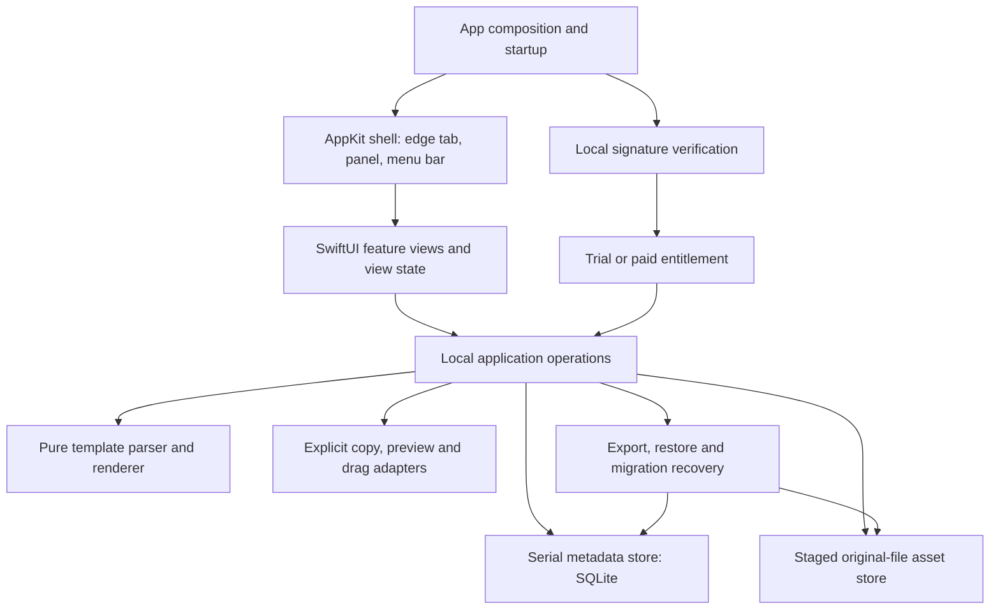

# Nivlet — architecture

Proposed implementation architecture · updated 27 October 2026 · application not yet built

[Requirements](nivlet-product-requirements.md) · [Phases](phases.md) · [Native UI guide](native-ui-guide.md) · [Agent skills](agent-skills.md)

## Purpose and constraints

A native Mac utility opens from a configurable edge tab and keeps a small project kit beside an existing AI app. The four tools are prompts (plain or with optional fill-in blanks; instructions merged into prompts on 27 October 2026), reference files, pockets and scratchpad. Users choose what to copy or attach.

Build one desktop application. No working-feature backend, embedded model, provider SDK, webview UI, chat integration or automatic disclosure is required. Website payment, signed licence delivery and optional update checks are separate distribution concerns.

The architecture follows the PRD's proposed SwiftUI/AppKit/SQLite direction. macOS 14 is a provisional floor; validate the real SDK/toolchain and native feasibility before finalising support. Newer APIs need availability guards and genuine fallbacks. No third-party library or database wrapper has been selected.

## Components and direction of dependencies



Arrows indicate coordination/dependency, not automatic data transmission. Feature views do not issue SQL, manage NSPanel instances, sign licences or send material to an AI provider. Use narrow protocols only at real test/platform boundaries; do not create a framework for every component.

| Boundary | Responsibilities | Excludes |
|---|---|---|
| App composition | Initialise stores, recover interrupted work, inject dependencies, create shell | Feature-specific business logic |
| Native shell | One active tab and content panel, display bounds, pin/tuck, first responder, menu-bar access | Saving files or rewriting content |
| Feature presentation | Cards, forms, references, pockets, notes, explicit actions and status | Storage transactions and window policy |
| Local operations | Validate commands, coordinate saves/imports/moves, produce results | Network model calls |
| Metadata store | Schema, pocket ownership, transactions, search and trash records | Heavy decoding or mutable UI state |
| Asset store | Staging, digests, immutable originals, thumbnails, export copies and cleanup | Moving/mutating source files |
| Transfer adapters | User-triggered pasteboard read through the standard paste action, pasteboard write, safe preview, file URLs/promises, Finder fallback | Background clipboard polling, custom-button pasteboard reads that trigger the privacy alert, or auto-send |
| Recovery | Consistent export, bounded restore, migration snapshot and rollback | Silent overwrite/merge |
| Licensing | Verify signed entitlement locally; enforce agreed creation limits | Storing issuer private keys or periodic renewal |

## Native shell and state

Use SwiftUI for the panel's content and AppKit where required for precise panel/tab lifecycle and focus. A small tab window and the content panel can be separate native windows managed by one shell controller; there is one active tab/panel pair rather than copies on every display.

Keep a small explicit state model: tucked/open, pinned/unpinned, active display, selected pocket/view/item, child editor/preview and pending save/error. A request to tuck must flush a draft or retain a recoverable draft/error; do not silently discard it.

- Outside-click observation must not swallow the destination application's click.
- Escape dismisses the current child surface first, then the panel.
- Opening/editing/copying must not inject keystrokes into another application.
- Keyboard shortcut opens on the pointer's display when feasible; display settings govern the resting tab.
- Clamp frames to the visible work area on wake, detach/reconnect and resolution changes.
- Pin applies above ordinary application windows, not an unverified promise to overlay every full-screen Space.
- Menu-bar access remains available if the edge tab is disabled or overlay behavior is unavailable.

Focus/display rules belong to the shell and are tested with real applications. Avoid solving a focus issue by requesting Accessibility permission or synthesising Command-V.

## Proposed source layout

These paths are future implementation targets, not existing files. This is the single canonical layout; other documents link here rather than repeating it:

```text
Nivlet.xcodeproj
Nivlet/
  App/             entry point, startup, dependency composition
  Platform/        shell, screens, clipboard, Quick Look, drag, settings
  Features/
    Panel/           shared shelf, commands, editor and style tokens
    Prompts/
    References/
    Pockets/
    Scratchpad/
  Domain/          value types and pure template parsing/rendering
  Storage/         SQLite, staged assets, migrations, exports and recovery
  Licensing/       signed payload verification and entitlement policy
NivletTests/   correctness and failure tests
docs/implementation/   measured evidence and actual decisions
```

Keep files/types small enough to understand. An app state object is not an excuse to invalidate every row whenever a scratchpad changes. Load rows/thumbnails incrementally when library size warrants it; add complexity based on measurement.

## Data model and ownership

| Record | Key relationships and fields |
|---|---|
| Pocket | Stable UUID, name, order, timestamps and current local view |
| Prompt | UUID, required pocket ID, label, reviewed source, favourite, order, uses-blanks flag; ordered unique field definitions when blanks are on. Stored in `text_items`; schema v3 migrated every former instruction row to a plain prompt |
| Filled draft | Template/pocket identity, current values, revision; separate from saved source |
| Reference | UUID, pocket ID, label, note, asset ID, order |
| Asset | Digest, original bytes, detected type/size, safe relative storage path; per-reference display name retained separately where needed |
| Scratchpad | One per pocket; plain text, checklist state and revision |
| Trash/recovery | Deleted records/assets still retained, expiry, pending operations and failed drafts |
| Preferences | Display/edge/size, shortcut, appearance and device-local view state |
| Entitlement | Signed licence payload/verification state, isolated from working content |

Pocket content belongs to one pocket. A duplicate receives independent item IDs/metadata; identical asset bytes may be shared internally. Moving an item is explicit. Switching pockets never changes provider conversations or memory.

Digest deduplication must preserve per-reference original names, even when identical bytes arrived under different names. Thumbnails are disposable derived data and must never replace originals. Relative asset paths must not be accepted blindly from an archive.

## Storage layout and concurrency

Proposed local application-support layout, with the actual bundle identifier finalised during implementation:

```text
<Application Support>/<bundle-id>/
  library.sqlite
  assets/<digest>/original
  staging/<operation-id>/
  recovery/
  snapshots/
<Caches>/<bundle-id>/thumbnails/
<Caches>/<bundle-id>/transfer-exports/
```

Store transient export copies long enough for the receiving application's async file read; do not delete them as soon as dragging ends. Define cleanup based on a safe retention policy and test actual destinations. Do not expose the internal immutable original as an editable drag target.

Keep AppKit and presentation changes on the main actor. Serialise metadata writes through one store boundary. Run hashing, copying and thumbnail work in cancellable background operations. A draft revision/operation identity prevents an old async save from overwriting newer edits or updating the wrong pocket's status.

Autosave is debounced by at most the PRD's 500 ms, then flushed on the specified lifecycle boundaries. Report Saved only after the relevant durable commit completes. Keep last-good data plus a visible recoverable failure; a UI delay must not be mistaken for a successful write.

**Implemented in Phase 2 (28 October 2026):** schema 4 journals a pending snapshot in a separate durable SQLite transaction before replacing the one-pocket library. The successful library transaction removes that intent atomically. Startup presents pending content for review with persistent Retry; routine focus/tuck flushes cannot accept it automatically. Autosave debounces at 300 ms. Copy preserves reviewed CRLF/CR/LF and Unicode unchanged. See [implementation, failure boundaries and measured evidence](implementation/phase2-persistence.md).

The journal, filesystem and SQLite have different failure boundaries. Startup recovery reconciles staged operations and orphans before destructive cleanup. Specify and test interruption points rather than describing a database transaction as an atomic file copy.

**Implemented in Phase 3 (29 October 2026):** `ReferenceAssetStore` stages/hashes/synchronises original bytes on a separate actor before the metadata commit. Per-file outcomes distinguish saved items, pending metadata, failures and large-file confirmation. Failed source grants can be replaced through the native picker; retries preserve successful IDs. Standard responder-chain paste consumes explicit file/image input, and bounded static previews never execute active content. Outgoing transfers prepare independent digest-verified export copies off-main. See [Phase 3 evidence and handoff limits](implementation/phase3-vertical-slice.md).

## Important flows

### Save and copy a prompt

Validate non-empty content → persist the current revision → show save outcome. A deliberate Copy action obtains the exact reviewed body, applies only documented line-ending normalisation and writes it to the clipboard. Display “Copied to clipboard,” never “Sent.” No title, note, file path or marketing is appended.

### Fill a prompt's blanks

Applies only to prompts with named blanks turned on. Parse saved source into literal spans and explicit field tokens. Repeated field names share a value. Reject malformed syntax when saving. Render by substituting values as literal text, without running a second token parse. Show that same rendered value in preview and copy it only when required fields are complete. Reset/edit warnings affect the draft, not saved source.

Keep brace escaping and naming rules in one parser rather than duplicating regex behavior in the editor, preview and copy action.

### Import and drag a reference

User chooses files → validate supported import/limits → stage bytes → compute digest → place/adopt immutable asset → commit metadata/reference ownership → report success per file. Cancellation/failure must leave no successful-looking broken reference. Recover or clean up orphaned staged bytes after interruption.

Reject folders rather than traversing them. Do not execute scripts/active HTML, automatically fetch linked pages or expand arbitrary archives. Bound previews/decoders. Explicit paste is the only clipboard-read path. It arrives through the responder chain's `paste:` (Edit ▸ Paste or Command-V), so the system treats it as user-initiated and does not raise the pasteboard privacy alert (macOS 15.4+). Use `NSPasteboard` detect methods, guarded by availability checks, to decide whether Paste is enabled without reading contents.

On Drag file, produce an export copy with the intended original display name; use file URLs/promises as the tested destination requires. Copy note remains independent. If drag is unsupported, reveal an export location for manual attachment. Receipt/understanding remains the destination's concern.

### Switch, move and delete

Flush/recover the current draft before changing local pocket/view. Async results retain their originating IDs. Moves update explicit ownership; duplicates use new IDs. Single deletions offer Undo; pocket deletions require confirmation and seven-day recoverable trash. Assets referenced by trash remain retained.

### Export, restore and migrate

Export from a consistent metadata snapshot and retain asset references until completion. Package versioned JSON and original assets; exclude paid entitlement and machine-specific display settings. Preview contents before transfer.

Restore to staging, bound expanded sizes/file counts, validate schemas/digests/paths, reject traversal/symlink escapes, then commit as new pockets. Failure leaves the existing library unchanged. A crash after file placement but before metadata commit is reconciled on startup. Never silently merge or overwrite user content.

Create a recoverable snapshot before migration. A SQLite snapshot must be consistent with its journal mode; copying a live database file alone is not a backup strategy. Clean assets only after checking live, trash and pending operation references.

## UI boundaries and references

The tab opens a text-readable toolkit, not a marketing landing page. Cards/Prompts/References/Notes share the pocket switcher and search. Use an internal inspector for preview/edit. Pinning the main panel does not imply additional detachable windows in v1.

Read [native UI guide](native-ui-guide.md), inspect [actual captured references](../references/ui-ux/refbox/README.md), and use [the selected skills](agent-skills.md). Reference pixels inform composition; they do not override the five-tool scope or establish native behavior.

## Offline licence and network boundaries

Only the verification public key belongs in the application. Licence issuance and private signing keys live outside the repository/app. Verify a versioned signed payload locally; a valid paid base entitlement has no periodic network renewal dependency.

Two-personal-Mac terms are a proposed policy, not a capability a purely offline verifier can reliably enforce. Record the trust/refund/recovery tradeoff explicitly. Trial/paid creation limits must not destroy or lock away previously saved content.

No pocket content/names/paths are sent to checkout, licence recovery, diagnostic services or update checks. Core tools have no network dependency. Automatic updates are optional; manual signed installers suffice for v1. Distribution remains outside working-data operations.

## Verification and build order

| Concern | Evidence |
|---|---|
| Window/focus/display | Real native checks for AC-01; record unsupported/untested Spaces/full-screen cases |
| Exact text/parser | AC-02/AC-03 tests of Unicode, escaping, repeated fields, literal values and preview/copy equality |
| Originals | AC-04 digests across import, restart, removed sources, transfer and restore |
| Isolation | AC-05 switching, similar labels, move/duplicate and trash/Undo |
| Recovery | AC-06 injected write/interruption failures and hostile bounded-archive cases |
| Licence | AC-07 valid/tampered payload and offline/date-change behavior |
| Accessibility | AC-08 actual keyboard/VoiceOver, contrast, enlarged text and reduced-motion checks |

Start with the native shell spike, then durable text, the complete one-pocket slice, multiple pockets, recovery, polish and distribution. See [the eight phases](phases.md). Add services only as their phase needs them.

## Open decisions and authoritative references

Resolve actual Xcode/SDK, macOS floor, Intel test access, shortcut mechanism, signing identity, DB/archive dependencies, full-screen behavior, final price/trial/seats and branding through the relevant phase. This document does not mark those choices approved or implemented.

Apple reference entry points for implementation: [NSPanel](https://developer.apple.com/documentation/appkit/nspanel), [NSPasteboard](https://developer.apple.com/documentation/appkit/nspasteboard), [Human Interface Guidelines](https://developer.apple.com/design/human-interface-guidelines/designing-for-macos) and [notarization](https://developer.apple.com/documentation/security/notarizing-macos-software-before-distribution). Verify concrete API declarations in the installed SDK/current official docs; community skill examples are not authority for availability.
